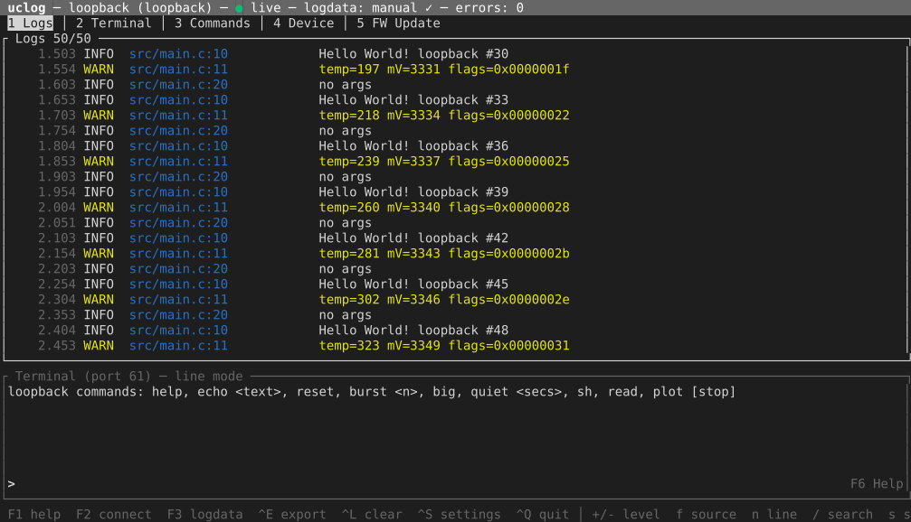

# `uclog`: GUI, TUI and command line

One program, `uclog`, for Linux, macOS and Windows: a native window, a terminal UI, and small
commands for scripts. Every command takes `-d` for the device ([addresses](hosts.md#connecting))
and `-l` for logdata files; `-v` logs more, `-vv` adds a hex trace of every byte.

## `uclog gui`

```sh
uclog gui                                      # connects when exactly one device is found, else opens Connect
uclog gui -d tcp://lab-pc:9000 -l build/app.elf --files-dir ./files
```


- **Views**, as tabs you can split, float and rearrange (the layout is kept): **Logs**,
  **Terminal**, **Commands**, **Device**, **FW Update**, and one tab per plot.
- **Logs:** filters for level, source, line and a regex; follow, *Discard filtered*, copy and CSV
  export. Double-click a row to show only its source; right-click for more, and to colour a
  source.
- **Terminal:** ANSI colours, history and buttons; the device's `printf()` (semihost) appears here.
- **Commands:** buttons from the settings, and a free line (text, or JSON sent as CBOR).
- **Plots:** up to three y axes, cursors with Δx, markers, heatmaps; CSV export.
- **Device:** what the device reports, the logdata in use, counters. *Load logdata…* also keeps
  the file in the cache for next time.
- **File menu:** Connect (⌘K), Load logdata (⌘L), Screenshot, Export all (⌘E), Settings (⌘,).

## `uclog tui`

```sh
uclog tui
uclog tui -d serial:/dev/ttyACM0 --plain | grep ERROR    # lines: ts:level:file:line:text
uclog tui --json --level WARN > warnings.jsonl           # one JSON record per line
uclog tui --plot-csv plots/                              # plot data to CSV files
```



- **Views:** 1 Logs (with the terminal below), 2 Terminal, 3 Commands, 4 Device, 5 FW Update.
  **Alt+1–5** switches from anywhere; **Esc** leaves the terminal.
- **F1** help, **F2** Connect (devices, hubs, a Bluetooth scan, an address), **F3** load
  logdata, **Ctrl+S** settings, **Ctrl+Q** quit.
- **Logs:** `+`/`-` level, `f` source (`s`: the selected row's), `n` line, `/` regex; `p` pause,
  `d` discard filtered, `c` copy, **Ctrl+E** CSV.
- **Terminal:** line mode with history; **Ctrl+T** for character mode (each key sent at once).
- A device that goes away is reopened every second until it is back.
- With `--plain` or `--json` (or when the output is not a terminal) it streams instead of drawing
  a UI.

## Commands

| Command | |
|---|---|
| `uclog list [--json] [--ble-scan 5]` | devices, hubs on this machine, and hubs on the network (mDNS) |
| `uclog term [-c LINE] [--exit-after S] [--raw] [--logs]` | the device's terminal (port 61) in this terminal; `-c` sends lines and `--exit-after` ends, for scripts |
| `uclog decode -l app.elf capture.bin` | decode a raw capture of the device's bytes (`-` for stdin) |
| `uclog fw-update -d auto app.signed.bin` | update the firmware (port 59, else port 3) |
| `uclog hub -d auto` | share the device: [the hub](hub.md) |

## Settings

The GUI and TUI share `settings.json`: buttons, history, colours, the logdata service and the
files folder. It is in `~/.config/uclog/` (Linux), `~/Library/Application Support/ca.unitcircle.uclog/`
(macOS) or `%APPDATA%\unitcircle\uclog\config\` (Windows); `--config` uses another file. The
logdata token is kept in the OS keyring, not in the file ([Logdata](logdata.md)).

For scripts and CI, options can come from the environment instead: `UCLOG_DEVICE`,
`UCLOG_LOGDATA_DOMAIN`, `UCLOG_LOGDATA_TOKEN`, `UCLOG_LOGDATA_URL` and `UCLOG_CACHE_DIR`. The
command line wins over the environment, which wins over the settings.

## Platform notes

- **Windows, Bluetooth:** throughput depends on the adapter's driver: one adapter went from about
  28 to 82 kB/s with its maker's current driver. Windows Update's is often years old.
- **WSL2** has no USB or Bluetooth: run a hub on Windows (or another machine) and connect to it by
  address; mDNS does not reach into WSL. There is no keyring either: give the token with
  `--logdata-token` or `UCLOG_LOGDATA_TOKEN`.
- **Linux:** the GUI needs a desktop (X11 or Wayland); the TUI and commands do not.
