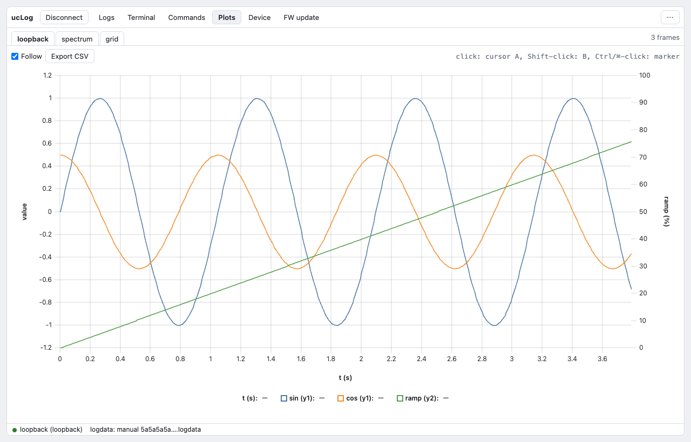
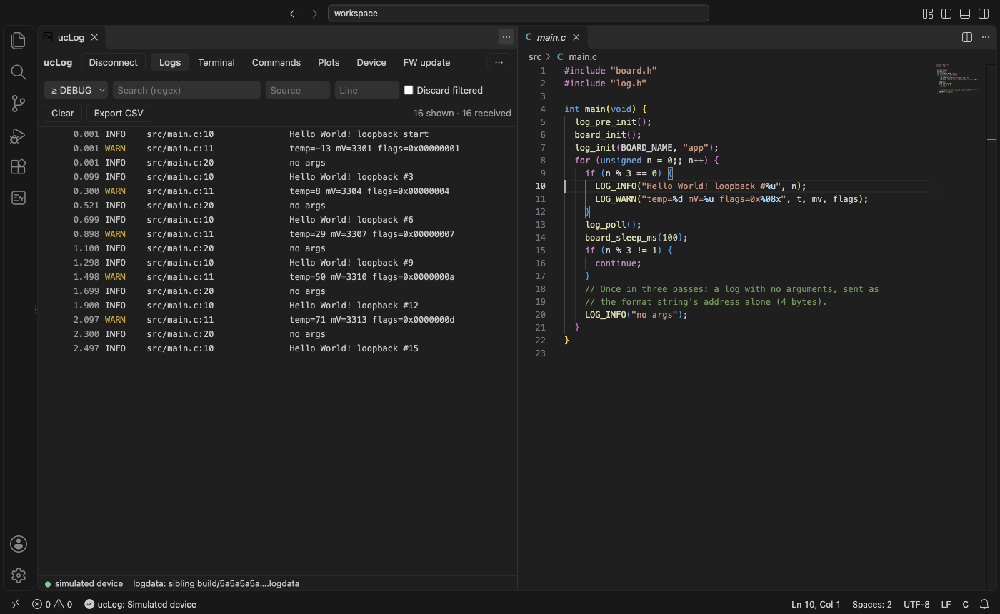
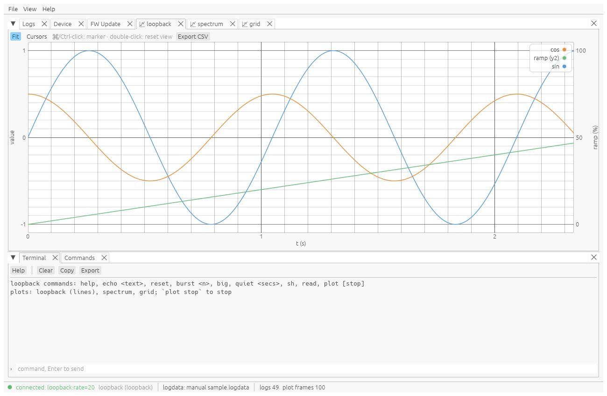

# The hosts

Every host reads the same device, the same logdata and the same wire protocol; pick the one that
fits where you work. These screenshots are made by the hosts' own tests, against the simulated
device (`build.py screenshots`).

## Web app

[uclog.unitcircle.ca/app/](web-app.md): logs, a terminal, commands, plots, device information and
firmware updates, in Chrome or Edge.

## VS Code

The same app in a VS Code panel: the logdata comes from the workspace's build, and clicking a log
opens the source line that wrote it.

## `uclog gui`

A native window (egui), for when there is no browser or VS Code.

## `uclog tui`

The terminal UI, also over SSH.

